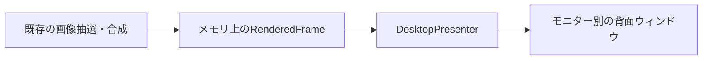

# デスクトップのメモリ描画

2026-10-18 / 調査起点はmainの0.4.8。現行仕様は[開発ガイド](../DEVELOPMENT.md)、検証範囲と未確認事項は[検証記録](../VERIFICATION.md)を参照。

## 1. 目的と採用方針

Windowsの壁紙設定を変更せず、メモリ内で合成した静止画をデスクトップのアイコンより背面へ表示する。画像切り替えに伴う合成BMP保存と、壁紙設定APIを起点とする`Themes/TranscodedWallpaper`の更新をなくす。

- 表示方式を専用ウィンドウへ置き換える。旧方式との切り替え設定や、失敗時の壁紙書き換えへの自動退避は設けない。
- モニター別フォルダー、表示モード、タイル、余白、抽選、履歴、更新間隔、手動停止の保存を引き継ぐ。AppDock本体のAPI変更は予定しない。
- 対象は表示用画像の保存とWindows背景設定への変更。元画像の読み込み、ホストの設定・ログ保存、履歴表示用サムネイルは既存仕様を維持する。

## 2. 構成と画像の受け渡し

| 担当 | 方針 |
| --- | --- |
| `WallpaperController` / `WallpaperRenderer` | 現在の全モニター合成処理を再利用。`Render`はファイルパスの代わりにBitmap・仮想画面矩形・モニター矩形・履歴候補を持つ`RenderedFrame`を返す |
| `LatestWorker` | 直列合成、最新要求の優先、設定変更や停止による無効化を維持。合成中の画像をUIから読まない |
| `DesktopPresenter`（新設） | STAのdispatcher上でフレームと表示ウィンドウを所有し、交換・再描画・非表示・破棄を行う |
| `DesktopHost`（新設） | Explorerの接続先探索、親子関係・重なり順、切断検知と再接続を担当。Win32呼び出しはfakeへ差し替え可能にする |

全モニターを囲む1枚のBitmapを共有し、モニターごとの軽量な`NativeWindow`で該当範囲を表示サイズに合わせて描画する。合成Bitmapの全体コピーは作らない。各Surfaceは専用の`BufferedGraphicsContext`を持ち、クライアントサイズのバッファに描画を完了してからDCへ転送する。互換Bitmapは再利用し、Surface破棄時に解放する。paint DCは描画呼出しの間だけ借用する。ウィンドウの生成・描画・フレーム交換・破棄は同じSTA上で直列化する。

現在の`LatestWorker.Publish`は結果を`using`で解放するため、Presenterへの所有権移動を明示する。受け入れ直前に`TakeBitmap()`等で一度だけ移し、移動後の`RenderedFrame.Dispose`は表示中Bitmapを解放しない。移動前の失敗・取消・古い世代の結果は結果側が解放し、移動後の適用失敗ではPresenterが新Bitmapを解放して旧画像を維持する。成功時は全Surfaceの参照を新フレームへ交換してから旧Bitmapを解放し、その時点で履歴を登録する。再描画や再接続だけでは履歴を増やさない。

静止中の常時描画ループは設けない。画像交換と必要な`WM_PAINT`で描画し、フレームの蓄積を防ぐ。初回表示時だけ`SetWindowPos`で配置し、通常の画像交換では再配置しない。保持は表示中・合成中・受け渡し待ちの最大3枚を上限とし、Surfaceごとの描画バッファ、画像ロード用一時メモリとOS側の描画Surfaceは別途計測する。32bitの4K画像1枚は約31.6MiBであり、ディスク保存の削減に伴って表示中の画像メモリは常駐する。

## 3. Explorerへの配置

`Progman` / `WorkerW` / `SHELLDLL_DefView`を探索し、アイコンより後ろ、Windowsの背景より前へ自前ウィンドウを配置する。従来のWorkerW構成と、Progman配下にアイコンと背景が分かれる構成を実際の親子関係から判別する。必要なデスクトップ層の生成要求は`SendMessageTimeout`で時間制限を設ける。

Layered子ウィンドウを利用するため、製品と回帰fixtureのEXEはapp.manifestでWindows 10/11対応を宣言する。dotnet.exe経由だけでなく実apphost・発行EXEを検証する。[Windowsの要件](https://learn.microsoft.com/en-us/windows/win32/winmsg/using-windows)

この配置方法はExplorer内部の構成に依存する。Livelyの[実装例](https://github.com/lively-community/lively/blob/core-separation/src/Lively/Lively/Core/WinDesktopCore.cs)を挙動の参考とし、全Windows版で同じ階層が存在するとは扱わない。まず最小試作で接続・入力・DPIを確認し、対応できたOSビルドを検証記録へ残す。

- 自前ウィンドウは枠なし・非アクティブ・タスクバー/Alt+Tab非表示とする。一般ウィンドウの最前面表示への退避や、Explorer既存ウィンドウの非表示・破棄は行わない。
- `WS_EX_LAYERED`と`WS_EX_TRANSPARENT`による入力透過を基本に、不透明度255で画像を表示する。アイコンのクリック、空白の右クリック、範囲選択、ドラッグ、ホイールがExplorerへ届くことを実機で確認する。独自の入力フックや`SendInput`による転送は追加しない。[Layered Windowsの仕様](https://learn.microsoft.com/en-us/windows/win32/winmsg/window-features#layered-windows)
- 画面の物理ピクセル矩形と親ウィンドウの座標を明示的に変換する。負の座標、縦置き、隙間、混在DPIを扱い、WinFormsの自動拡縮を重ねない。
- 現行のPerMonitorV2設定を起点に、接続先のDPIコンテキストとSurface生成時のコンテキストを整合させる。`SetParent`のスタイル変更とDPI不一致の制約を確認し、プロセス全体のDPIモードを暗黙に変える実装にしない。親のDPIコンテキストへ一時的に切り替えてNativeWindowを生成し、元のスレッドコンテキストへ戻す。親を指定して生成するためSetParent自体は使わない。[SetParentの仕様](https://learn.microsoft.com/en-us/windows/win32/api/winuser/nf-winuser-setparent)

親・アイコン層・重なり順を確認できるまでは非表示にし、安全に配置できたSurfaceだけを表示する。画面構成やDPIが変わったら古い合成要求を無効化し、矩形・接続先を取り直して再合成する。

## 4. 停止・復旧・終了

| 状態・契機 | 動作 |
| --- | --- |
| 開始・再開 | 停止条件を確認し、接続と初回合成が揃ってから表示。手動停止で起動した場合は表示しない |
| 定期更新・次の壁紙 | 現在の表示を保って次の画像を合成し、正常完了した最新結果へ交換 |
| 手動停止・ロック・リモート接続 | 更新を止め、要求を無効化し、Surfaceを非表示にして表示画像を解放。手動・ロック・リモートの理由は独立して保持 |
| 停止条件の解除 | すべて解除された場合だけ再接続・再合成して表示。手動停止は自動解除しない |
| Explorer再起動・接続先の破棄 | 表示先を無効化し、更新による画像抽選を一時停止。元のBitmapを保持できる場合は再接続後に再表示し、画面構成が変わった場合だけ再合成 |
| 無効化・通常終了・Windows終了確定 | 合成を無効化し、自前ウィンドウ・Bitmap・タイマー・イベント購読を解放。Windows背景APIは呼ばない |

`TaskbarCreated`と接続先の破棄通知を復旧の契機にする。UIへ送るコールバックにも接続世代と停止状態を照合し、停止後の遅延表示を防ぐ。Explorer側に破棄された自前HWNDは再作成し、古いハンドル値を再利用しない。

再接続は1・2・5・10・30秒後の最大5回とし、同じ失敗を毎秒記録しない。成功前は画像抽選を進めず、新しいExplorer生成通知、明示的な「次の壁紙」、またはApplet再起動で再試行できるようにする。停止中は接続・表示の再試行を行わない。

既存の停止状態`IsPaused`（手動・ロック・リモートの合成）と、表示状態（準備中・表示中・再接続待ち・表示エラー）を区別する。失敗時に保存済み`paused`を書き換えず、既存パネルの状態表示とホスト共通エラーログへ理由を出す。初回配置失敗はWindows背景をそのまま表示し、通常更新の合成失敗では前の有効画像を維持する。

`WM_QUERYENDSESSION`では許可だけを返し、取消時は継続する。`WM_ENDSESSION(wParam=true)`内の同期停止、通常deactivateとの二重停止防止、現在の終了優先度とホストログ接続を維持する。停止はネットワーク上の画像ロード完了を待たない。

Surfaceを隠した後に見えるのは、その時点でWindowsに設定されている背景である。
